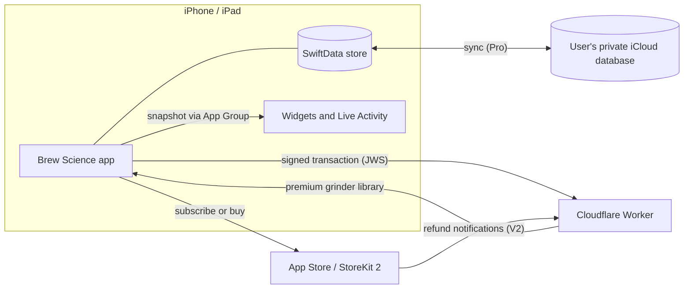

# Brew Science

[English](README.md) | [简体中文](README.zh-CN.md)

A native iOS coffee brewing toolkit. Pick a brew method and follow it step by step: weigh, pour, time. Scan a bean bag to log it, convert grinder settings between 121 grinders, make tasting cards. No account, no ads.

  
  &nbsp;
  

## Stack

| | |
|---|---|
| Language | Swift 6, strict concurrency |
| UI | SwiftUI, iOS 26+, system Liquid Glass components |
| Data | SwiftData; iCloud sync through the user's own private CloudKit database |
| Purchases | StoreKit 2: yearly subscription and one-time Lifetime purchase |
| System surfaces | WidgetKit (home and lock screen), Live Activities |
| On-device ML | Vision text recognition (Chinese + English), Foundation Models |
| Server | Cloudflare Worker (TypeScript) for purchase verification |
| Languages | English, Simplified Chinese |

## Architecture

## Engineering highlights

- Account-free purchase verification: StoreKit 2 signed transactions checked against a pinned Apple root certificate; refunds handled through App Store Server Notifications V2.
- Bean bag scanning: on-device OCR and a rule parser, with on-device Foundation Models filling gaps only when the recognized text backs the answer.
- Particle size from a photo: thresholding, connected-component analysis and a printed calibration square, reported as volume-weighted D10/D50/D90.
- Subscription and Lifetime state verified on the device, with an offline grace period.

## Privacy

- No account, no analytics, no ads.
- Records stay on the device, or in the user's own private iCloud database with sync on.
- [Privacy policy](https://brewscience.win/privacy/)

## Engineering practice

- Swift Testing unit tests, including StoreKit Test scenarios for purchase, expiry and refund.
- Pre-commit and release gates for paywall disclosures, design tokens, Chinese punctuation and localization terms.
