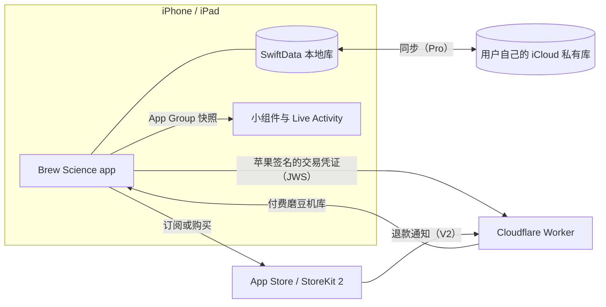

# Brew Science

[English](README.md) | [简体中文](README.zh-CN.md)

原生 iOS 咖啡冲煮工具箱。在家冲，也能出门喝：选好豆子和配方，按步骤称豆、注水、计时；喝到好咖啡，做一张品鉴卡。拍豆袋自动录入，121 台磨豆机刻度互转，生成品鉴卡。无账号、无广告。

  
  &nbsp;
  

## 技术栈

| | |
|---|---|
| 语言 | Swift 6，严格并发检查 |
| 界面 | SwiftUI，iOS 26 起，使用系统 Liquid Glass 组件 |
| 数据 | SwiftData；iCloud 同步走用户自己的 CloudKit 私有库 |
| 付费 | StoreKit 2：年度订阅与一次性终身版 |
| 系统入口 | WidgetKit（主屏与锁屏小组件），Live Activity |
| 模型 | Vision 文字识别（中英文，本机）；Foundation Models（Private Cloud Compute，无网时用本机模型） |
| 服务端 | Cloudflare Worker（TypeScript），用于购买验证 |
| 语言 | 英文、简体中文 |

## 架构

## 工程要点

- 无账号的购买验证：用固定的苹果根证书校验 StoreKit 2 签名交易；退款通过 App Store 服务器通知 V2 处理。
- 拍豆袋识别：照片和本机识别出的文字通过 Foundation Models 交给 Apple 的 Private Cloud Compute；不可用时由本机模型和规则解析接手，各层共用 15 秒时限。
- 拍照测粒径：阈值分割、连通域分析和打印标定方块，输出按体积加权的 D10/D50/D90。
- 订阅与终身版状态在设备上校验，离线有宽限期。

## 隐私

- 无账号、无统计、无广告。
- 记录存在设备上；开启同步后，存在用户自己的 iCloud 私有库。
- [隐私政策](https://brewscience.win/privacy/)（英文）

## 工程实践

- Swift Testing 单元测试，包括用 StoreKit Test 模拟购买、到期和退款。
- 提交与发版门禁：付费墙条款、设计令牌、中文标点、本地化术语。
